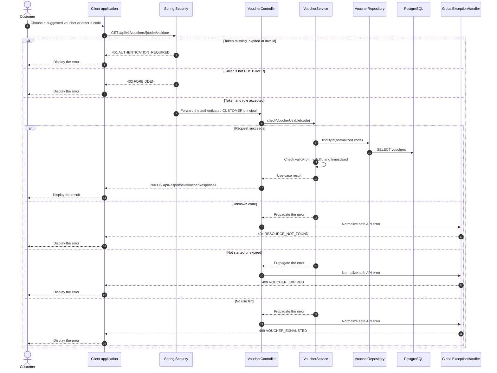

# Voucher - Apply Voucher — Sequence Diagram

- **Use-case spec:** [apply-voucher.vi.md](../../usecase-specification/customer/apply-voucher.vi.md)
- **API route/status:** `GET /api/v1/vouchers/{code}/validate` — Confirmed
- **Feature API contract:** [features/voucher/API_CONTRACT.md](../../features/voucher/API_CONTRACT.md)

