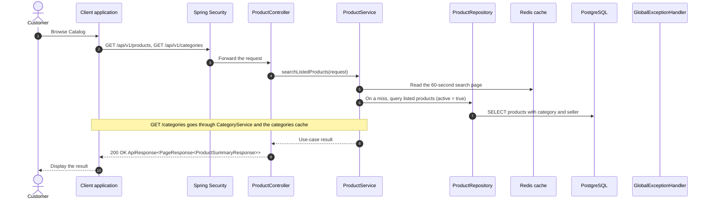

# Catalog - Browse Catalog — Sequence Diagram

- **Use-case spec:** [browse-catalog.vi.md](../../usecase-specification/customer/browse-catalog.vi.md)
- **API route/status:** `GET /api/v1/products, GET /api/v1/categories` — Confirmed
- **Feature API contract:** [features/catalog/API_CONTRACT.md](../../features/catalog/API_CONTRACT.md)

