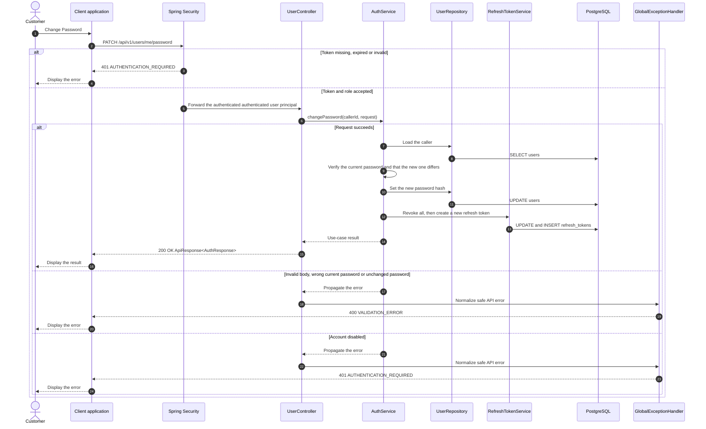

# Auth - Change Password — Sequence Diagram

- **Use-case spec:** [change-password.vi.md](../../usecase-specification/customer/change-password.vi.md)
- **API route/status:** `PATCH /api/v1/users/me/password` — Confirmed
- **Feature API contract:** [features/auth/API_CONTRACT.md](../../features/auth/API_CONTRACT.md)

