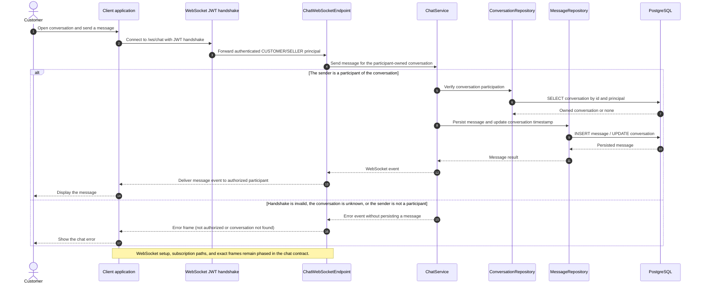

# Chat - Chat with Seller — Sequence Diagram

- **Use-case spec:** [chat-with-seller.vi.md](../../usecase-specification/customer/chat-with-seller.vi.md)
- **API route/status:** `WebSocket /ws/chat (message frames are phased)` — Phased
- **Feature API contract:** [features/chat/API_CONTRACT.md](../../features/chat/API_CONTRACT.md)

> **Target sequence:** endpoint status is not fully Confirmed (see API contract link). Layer names are planned placeholders; the backend scaffold does not yet implement them.

