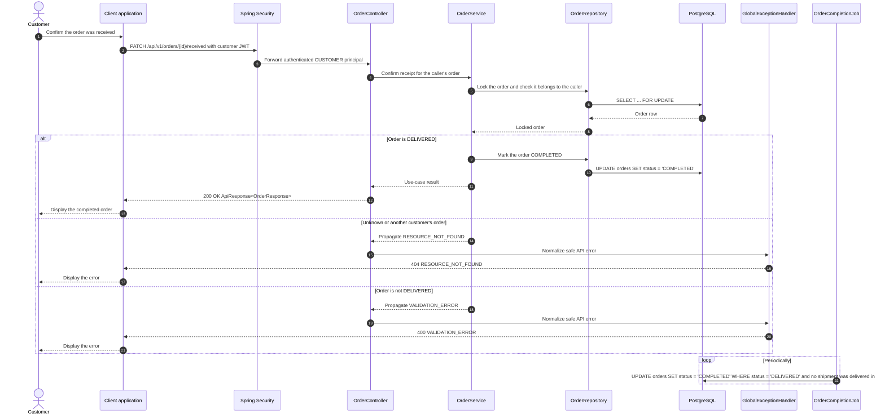

# Order - Confirm Order Received — Sequence Diagram

- **Use-case spec:** [confirm-order-received.vi.md](../../usecase-specification/customer/confirm-order-received.vi.md)
- **API route/status:** `PATCH /api/v1/orders/{id}/received` — Confirmed
- **Feature API contract:** [features/order/API_CONTRACT.md](../../features/order/API_CONTRACT.md)

> Confirming receipt closes the order (`DELIVERED -> COMPLETED`) and changes no payment: COD was recorded as collected at delivery. Without confirmation, a background job completes the order 3 days after its last shipment was delivered.

