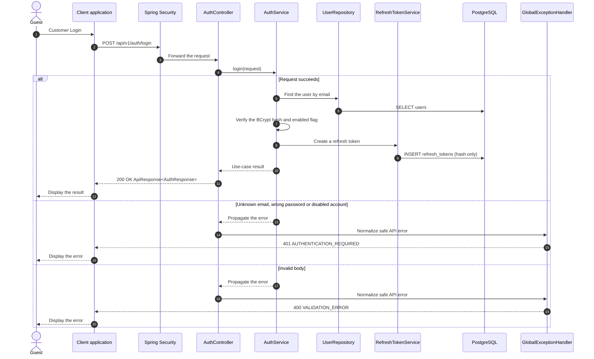

# Auth - Customer Login — Sequence Diagram

- **Use-case spec:** [login.vi.md](../../usecase-specification/customer/login.vi.md)
- **API route/status:** `POST /api/v1/auth/login` — Confirmed
- **Feature API contract:** [features/auth/API_CONTRACT.md](../../features/auth/API_CONTRACT.md)

