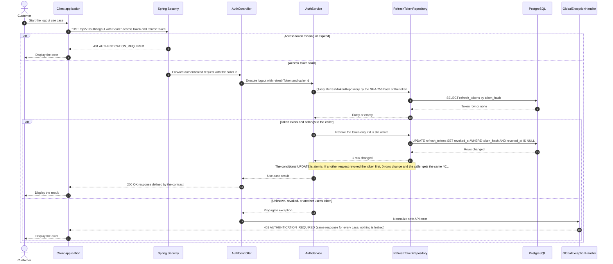

# Auth - Logout — Sequence Diagram

- **Use-case spec:** [logout.vi.md](../../usecase-specification/customer/logout.vi.md)
- **API route/status:** `POST /api/v1/auth/logout` — Confirmed
- **Feature API contract:** [features/auth/API_CONTRACT.md](../../features/auth/API_CONTRACT.md)

> **Shared use case:** Seller and Admin log out through the same endpoint and the same flow; there is no separate diagram for them. Logout revokes only the refresh token. The access token is stateless and stays valid until it expires (at most 15 minutes).

