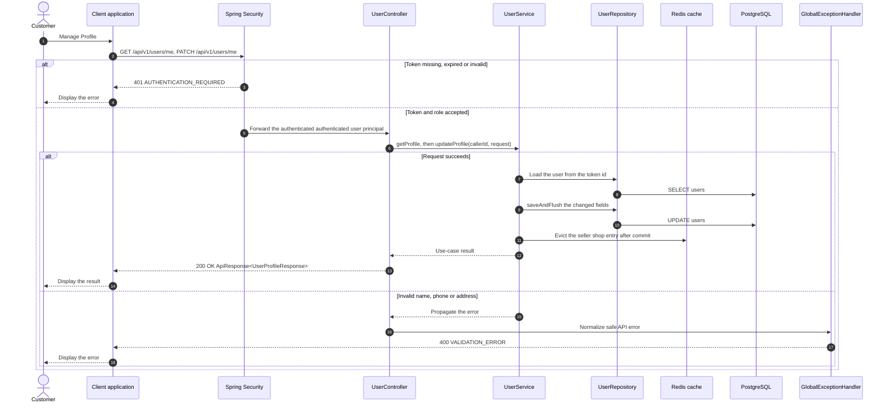

# User - Manage Profile — Sequence Diagram

- **Use-case spec:** [manage-profile.vi.md](../../usecase-specification/customer/manage-profile.vi.md)
- **API route/status:** `GET /api/v1/users/me, PATCH /api/v1/users/me` — Confirmed
- **Feature API contract:** [features/user/API_CONTRACT.md](../../features/user/API_CONTRACT.md)

