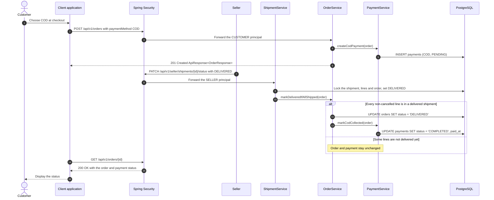

# Payment - Pay for Order (COD) — Sequence Diagram

- **Use-case spec:** [pay-for-order-cod.vi.md](../../usecase-specification/customer/pay-for-order-cod.vi.md)
- **API route/status:** `POST /api/v1/orders (paymentMethod = COD), PATCH /api/v1/seller/shipments/{id}/status` — Confirmed
- **Feature API contract:** [features/payment/API_CONTRACT.md](../../features/payment/API_CONTRACT.md)

> COD has no payment endpoint of its own. It starts at checkout and completes from the seller's shipment update.

