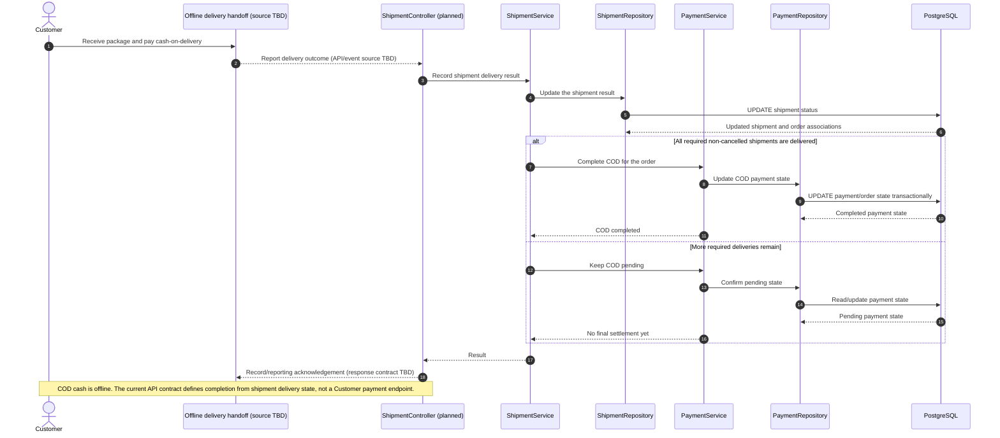

# Payment - Pay for Order (COD) — Sequence Diagram

- **Use-case spec:** [pay-for-order-cod.vi.md](../../usecase-specification/customer/pay-for-order-cod.vi.md)
- **API route/status:** `No customer COD endpoint is defined; delivery-result trigger is TBD` — TBD
- **Feature API contract:** [features/shipment/API_CONTRACT.md](../../features/shipment/API_CONTRACT.md)

> **Endpoint gap:** COD cash is offline and the API contract defines settlement from shipment delivery state; it does not define a Customer payment endpoint or delivery-event source.

