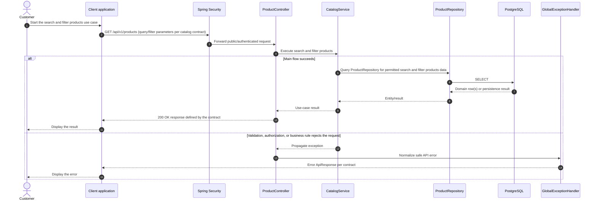

# Catalog - Search and Filter Products — Sequence Diagram

- **Use-case spec:** [search-and-filter-products.vi.md](../../usecase-specification/customer/search-and-filter-products.vi.md)
- **API route/status:** `GET /api/v1/products (query/filter parameters per catalog contract)` — Confirmed
- **Feature API contract:** [features/catalog/API_CONTRACT.md](../../features/catalog/API_CONTRACT.md)

> **Target sequence:** controller/service/repository names are planned placeholders; the current backend scaffold does not yet implement these layers.

