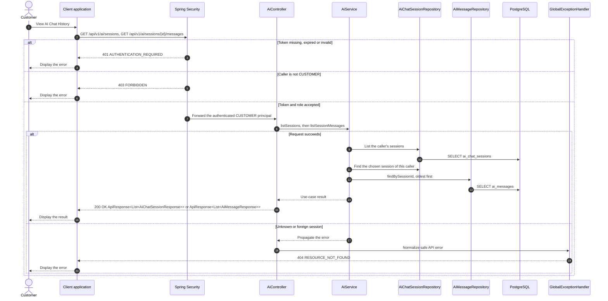

# AI - View AI Chat History — Sequence Diagram

- **Use-case spec:** [view-ai-chat-history.vi.md](../../usecase-specification/customer/view-ai-chat-history.vi.md)
- **API route/status:** `GET /api/v1/ai/sessions, GET /api/v1/ai/sessions/{id}/messages` — Confirmed
- **Feature API contract:** [features/ai/API_CONTRACT.md](../../features/ai/API_CONTRACT.md)

