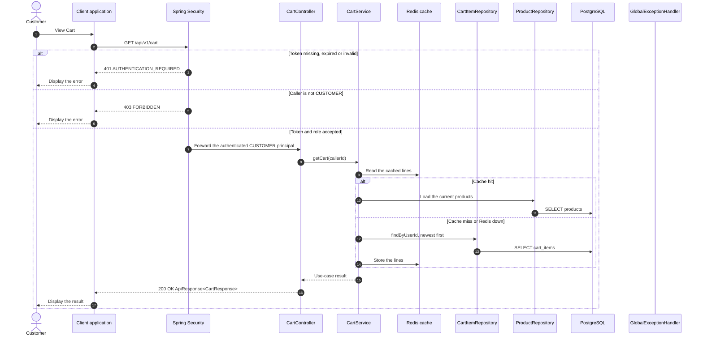

# Cart - View Cart — Sequence Diagram

- **Use-case spec:** [view-cart.vi.md](../../usecase-specification/customer/view-cart.vi.md)
- **API route/status:** `GET /api/v1/cart` — Confirmed
- **Feature API contract:** [features/cart/API_CONTRACT.md](../../features/cart/API_CONTRACT.md)

