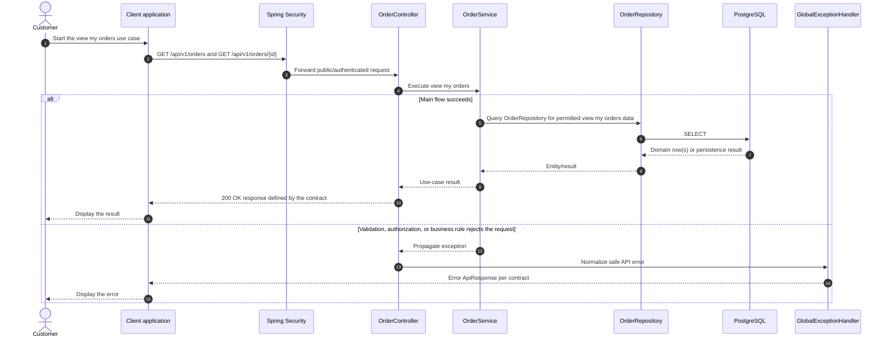

# Order - View My Orders — Sequence Diagram

- **Use-case spec:** [view-my-orders.vi.md](../../usecase-specification/customer/view-my-orders.vi.md)
- **API route/status:** `GET /api/v1/orders and GET /api/v1/orders/{id}` — Confirmed
- **Feature API contract:** [features/order/API_CONTRACT.md](../../features/order/API_CONTRACT.md)

> **Target sequence:** controller/service/repository names are planned placeholders; the current backend scaffold does not yet implement these layers.

