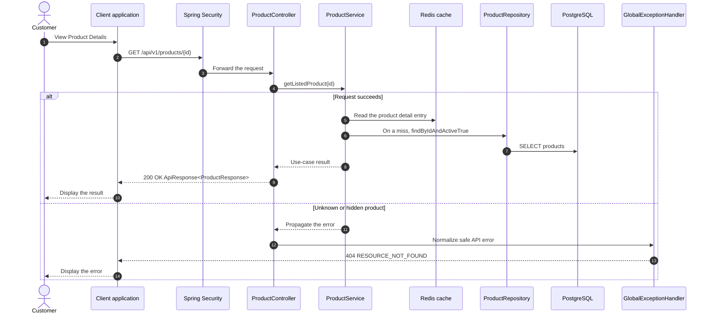

# Catalog - View Product Details — Sequence Diagram

- **Use-case spec:** [view-product-details.vi.md](../../usecase-specification/customer/view-product-details.vi.md)
- **API route/status:** `GET /api/v1/products/{id}` — Confirmed
- **Feature API contract:** [features/catalog/API_CONTRACT.md](../../features/catalog/API_CONTRACT.md)

