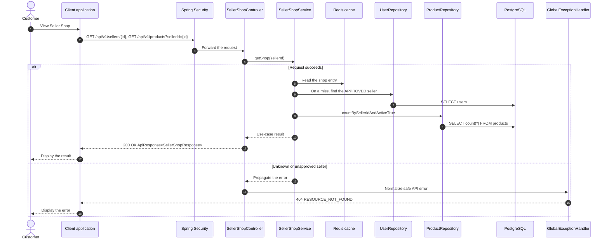

# Catalog - View Seller Shop — Sequence Diagram

- **Use-case spec:** [view-seller-shop.vi.md](../../usecase-specification/customer/view-seller-shop.vi.md)
- **API route/status:** `GET /api/v1/sellers/{id}, GET /api/v1/products?sellerId={id}` — Confirmed
- **Feature API contract:** [features/catalog/API_CONTRACT.md](../../features/catalog/API_CONTRACT.md)

