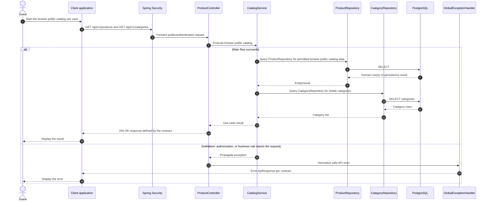

# Catalog - Browse Public Catalog — Sequence Diagram

- **Use-case spec:** [browse-public-catalog.vi.md](../../usecase-specification/guest/browse-public-catalog.vi.md)
- **API route/status:** `GET /api/v1/products and GET /api/v1/categories` — Confirmed
- **Feature API contract:** [features/catalog/API_CONTRACT.md](../../features/catalog/API_CONTRACT.md)

> **Target sequence:** controller/service/repository names are planned placeholders; the current backend scaffold does not yet implement these layers.

