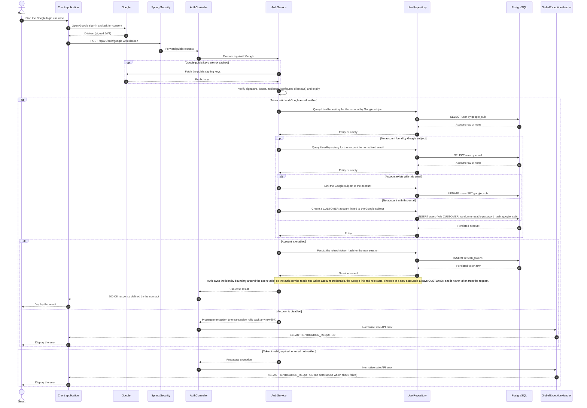

# Auth - Guest Login with Google — Sequence Diagram

- **Use-case spec:** [login-with-google.vi.md](../../usecase-specification/guest/login-with-google.vi.md)
- **API route/status:** `POST /api/v1/auth/google` — Planned
- **Feature API contract:** [features/auth/API_CONTRACT.md](../../features/auth/API_CONTRACT.md)

> **Target sequence:** controller/service/repository names are planned placeholders. The client obtains the Google ID token itself (Google sign-in screen); the backend only receives the token, verifies it, and never trusts an email sent separately by the client. After verification the flow issues the same token pair as `POST /api/v1/auth/login`.

