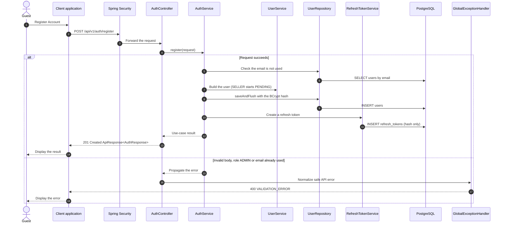

# Auth - Register Account — Sequence Diagram

- **Use-case spec:** [register-account.vi.md](../../usecase-specification/guest/register-account.vi.md)
- **API route/status:** `POST /api/v1/auth/register` — Confirmed
- **Feature API contract:** [features/auth/API_CONTRACT.md](../../features/auth/API_CONTRACT.md)

