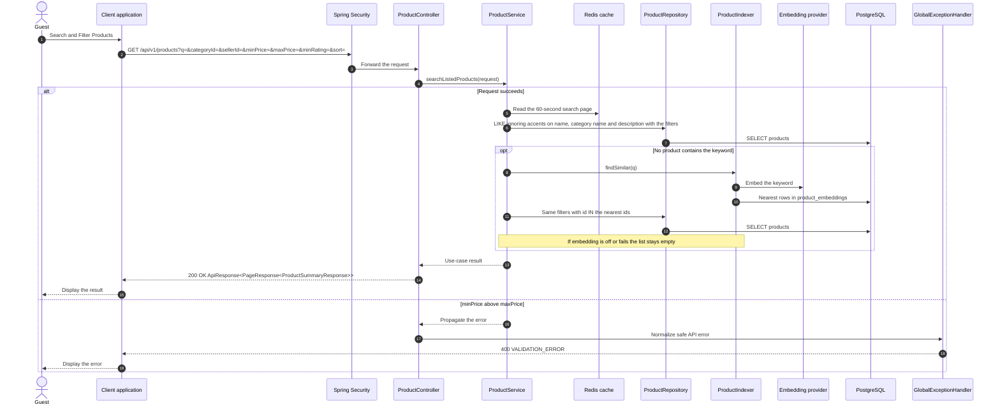

# Catalog - Search and Filter Products — Sequence Diagram

- **Use-case spec:** [search-and-filter-products.vi.md](../../usecase-specification/guest/search-and-filter-products.vi.md)
- **API route/status:** `GET /api/v1/products?q=&categoryId=&sellerId=&minPrice=&maxPrice=&minRating=&sort=` — Confirmed
- **Feature API contract:** [features/catalog/API_CONTRACT.md](../../features/catalog/API_CONTRACT.md)

