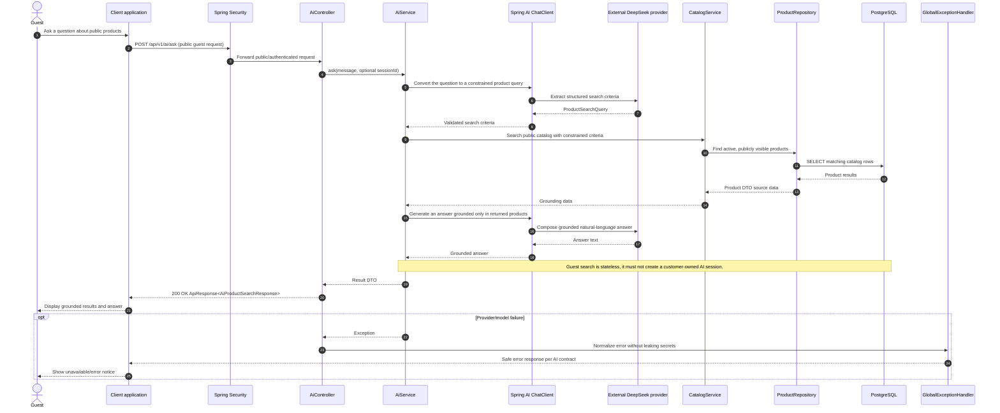

# AI - Search Products with AI Assistant — Sequence Diagram

- **Use-case spec:** [use-ai-product-search.vi.md](../../usecase-specification/guest/use-ai-product-search.vi.md)
- **API route/status:** `POST /api/v1/ai/ask` — Planned
- **Feature API contract:** [features/ai/API_CONTRACT.md](../../features/ai/API_CONTRACT.md)

> **Target sequence:** endpoint status is not fully Confirmed (see API contract link). Layer names are planned placeholders; the backend scaffold does not yet implement them.

