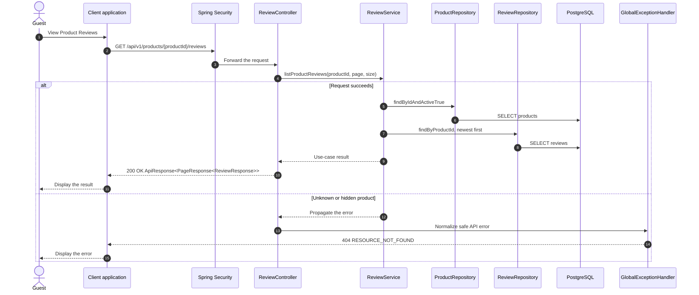

# Review - View Product Reviews — Sequence Diagram

- **Use-case spec:** [view-product-reviews.vi.md](../../usecase-specification/guest/view-product-reviews.vi.md)
- **API route/status:** `GET /api/v1/products/{productId}/reviews` — Confirmed
- **Feature API contract:** [features/review/API_CONTRACT.md](../../features/review/API_CONTRACT.md)

