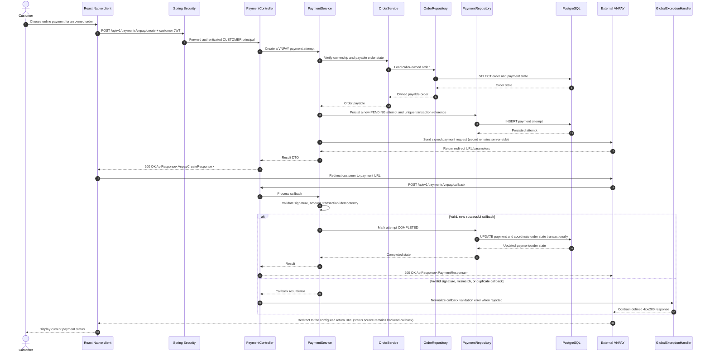

# VNPAY Payment Integration — Sequence Diagram

- **Source:** [Payment API contract](../../features/payment/API_CONTRACT.md), predicted `POST /api/v1/payments/vnpay/create` and `POST /api/v1/payments/vnpay/callback`.
- **Scope:** supplemental integration flow; not one of the 60 use-case specifications.

> **Target sequence:** payment service/controller/repository classes are planned placeholders. VNPAY endpoints and payload details remain Predicted in the API contract; provider secrets stay on the backend.

