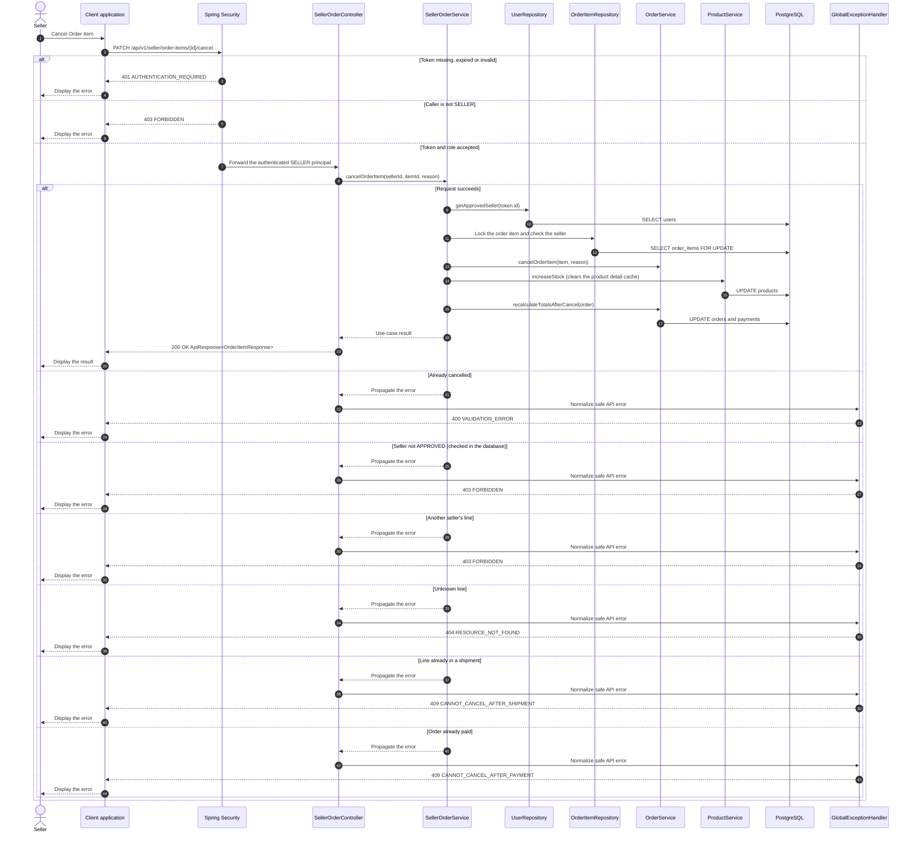

# Order - Cancel Order Item — Sequence Diagram

- **Use-case spec:** [cancel-order-item.vi.md](../../usecase-specification/seller/cancel-order-item.vi.md)
- **API route/status:** `PATCH /api/v1/seller/order-items/{id}/cancel` — Confirmed
- **Feature API contract:** [features/order/API_CONTRACT.md](../../features/order/API_CONTRACT.md)

