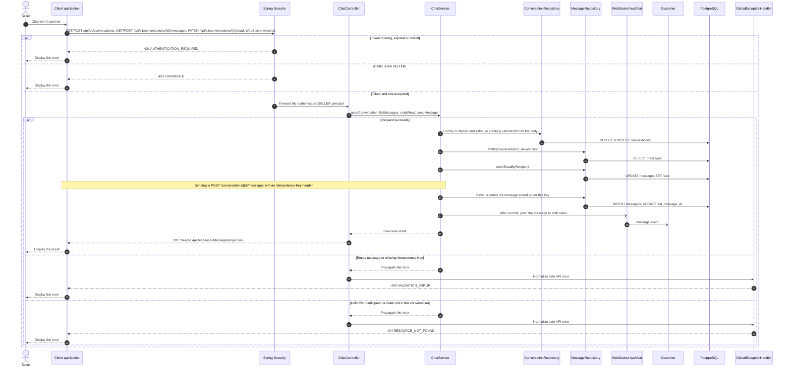

# Chat - Chat with Customer — Sequence Diagram

- **Use-case spec:** [chat-with-customer.vi.md](../../usecase-specification/seller/chat-with-customer.vi.md)
- **API route/status:** `GET/POST /api/v1/conversations, GET/POST /api/v1/conversations/{id}/messages, PATCH /api/v1/conversations/{id}/read, WebSocket /ws/chat` — Confirmed
- **Feature API contract:** [features/chat/API_CONTRACT.md](../../features/chat/API_CONTRACT.md)

