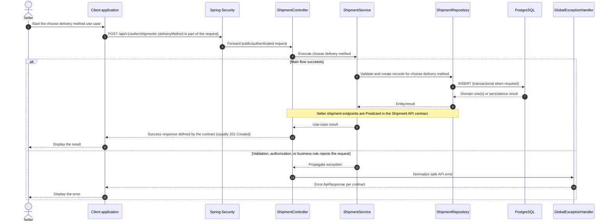

# Shipment - Choose Delivery Method — Sequence Diagram

- **Use-case spec:** [choose-delivery-method.vi.md](../../usecase-specification/seller/choose-delivery-method.vi.md)
- **API route/status:** `POST /api/v1/seller/shipments (deliveryMethod is part of the request)` — Predicted
- **Feature API contract:** [features/shipment/API_CONTRACT.md](../../features/shipment/API_CONTRACT.md)

> **Target sequence:** endpoint status is not fully Confirmed (see API contract link). Layer names are planned placeholders; the backend scaffold does not yet implement them.

