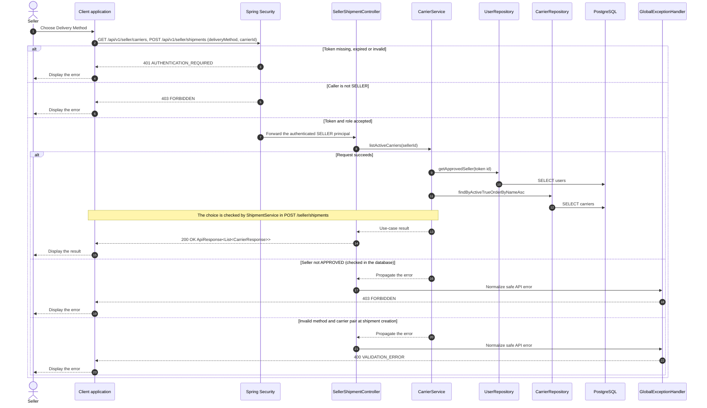

# Shipment - Choose Delivery Method — Sequence Diagram

- **Use-case spec:** [choose-delivery-method.vi.md](../../usecase-specification/seller/choose-delivery-method.vi.md)
- **API route/status:** `GET /api/v1/seller/carriers, POST /api/v1/seller/shipments (deliveryMethod, carrierId)` — Confirmed
- **Feature API contract:** [features/shipment/API_CONTRACT.md](../../features/shipment/API_CONTRACT.md)

