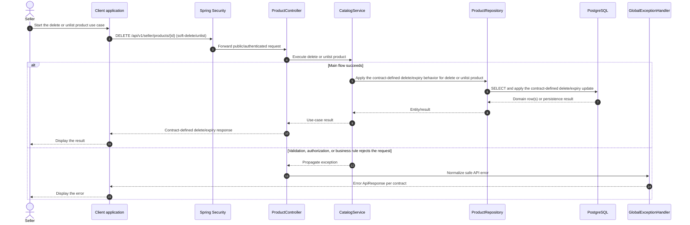

# Catalog - Delete or Unlist Product — Sequence Diagram

- **Use-case spec:** [delete-or-unlist-product.vi.md](../../usecase-specification/seller/delete-or-unlist-product.vi.md)
- **API route/status:** `DELETE /api/v1/seller/products/{id} (soft-delete/unlist)` — Confirmed
- **Feature API contract:** [features/catalog/API_CONTRACT.md](../../features/catalog/API_CONTRACT.md)

> **Target sequence:** controller/service/repository names are planned placeholders; the current backend scaffold does not yet implement these layers.

