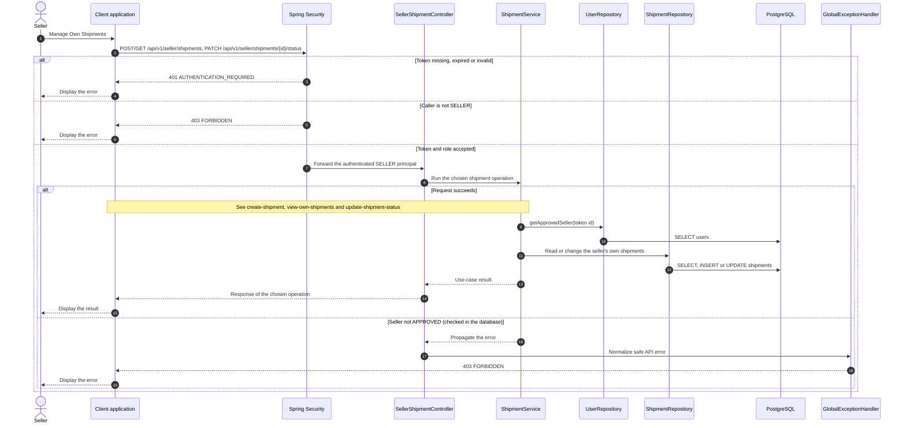

# Shipment - Manage Own Shipments — Sequence Diagram

- **Use-case spec:** [manage-own-shipments.vi.md](../../usecase-specification/seller/manage-own-shipments.vi.md)
- **API route/status:** `POST/GET /api/v1/seller/shipments, PATCH /api/v1/seller/shipments/{id}/status` — Confirmed
- **Feature API contract:** [features/shipment/API_CONTRACT.md](../../features/shipment/API_CONTRACT.md)

