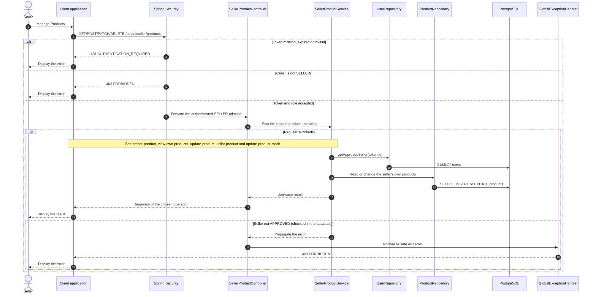

# Catalog - Manage Products — Sequence Diagram

- **Use-case spec:** [manage-products.vi.md](../../usecase-specification/seller/manage-products.vi.md)
- **API route/status:** `GET/POST/PATCH/DELETE /api/v1/seller/products` — Confirmed
- **Feature API contract:** [features/catalog/API_CONTRACT.md](../../features/catalog/API_CONTRACT.md)

