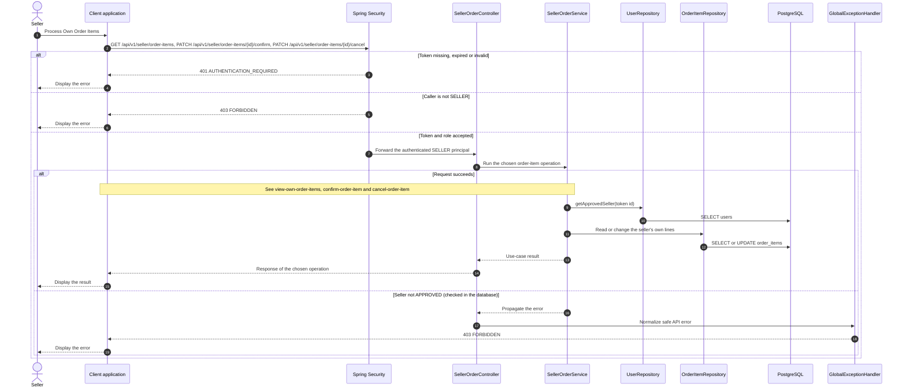

# Order - Process Own Order Items — Sequence Diagram

- **Use-case spec:** [process-own-order-items.vi.md](../../usecase-specification/seller/process-own-order-items.vi.md)
- **API route/status:** `GET /api/v1/seller/order-items, PATCH /api/v1/seller/order-items/{id}/confirm, PATCH /api/v1/seller/order-items/{id}/cancel` — Confirmed
- **Feature API contract:** [features/order/API_CONTRACT.md](../../features/order/API_CONTRACT.md)

