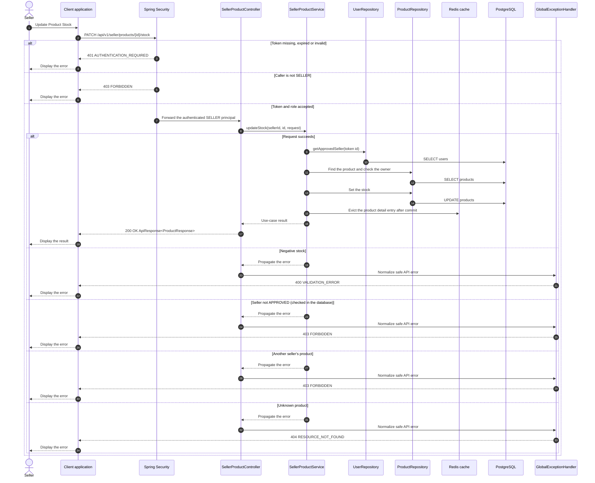

# Catalog - Update Product Stock — Sequence Diagram

- **Use-case spec:** [update-product-stock.vi.md](../../usecase-specification/seller/update-product-stock.vi.md)
- **API route/status:** `PATCH /api/v1/seller/products/{id}/stock` — Confirmed
- **Feature API contract:** [features/catalog/API_CONTRACT.md](../../features/catalog/API_CONTRACT.md)

