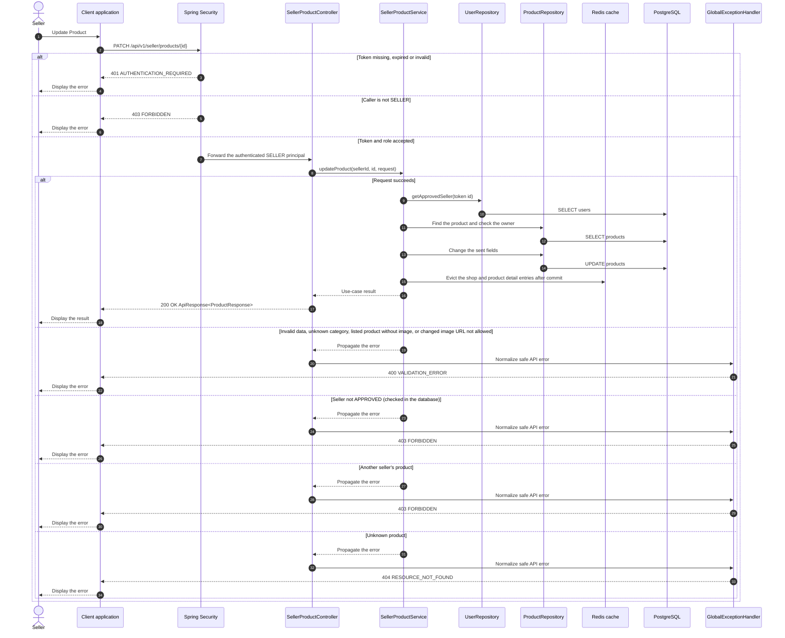

# Catalog - Update Product — Sequence Diagram

- **Use-case spec:** [update-product.vi.md](../../usecase-specification/seller/update-product.vi.md)
- **API route/status:** `PATCH /api/v1/seller/products/{id}` — Confirmed
- **Feature API contract:** [features/catalog/API_CONTRACT.md](../../features/catalog/API_CONTRACT.md)

