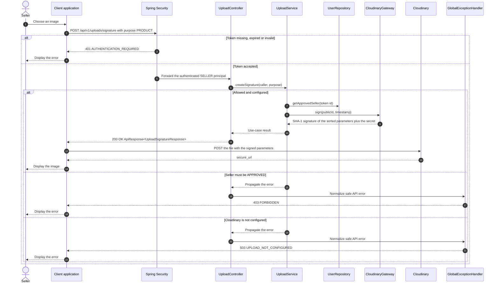

# Upload - Upload Image — Sequence Diagram

- **Use-case spec:** [upload-image.vi.md](../../usecase-specification/seller/upload-image.vi.md)
- **API route/status:** `POST /api/v1/uploads/signature, then POST to Cloudinary` — Confirmed
- **Feature API contract:** [features/upload/API_CONTRACT.md](../../features/upload/API_CONTRACT.md)

> The file never passes through the backend. The returned URL is then sent as imageUrl to the product or chat endpoint.

