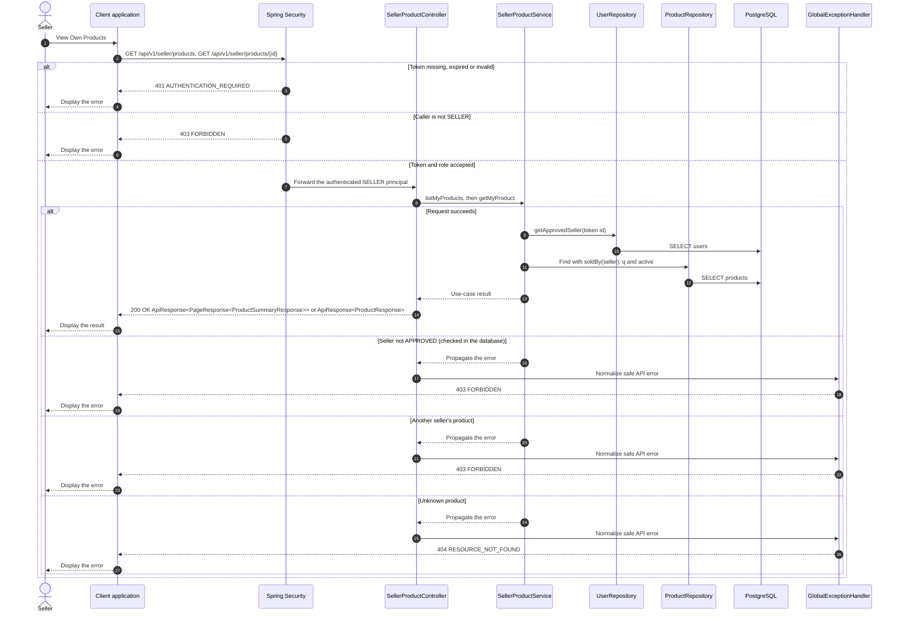

# Catalog - View Own Products — Sequence Diagram

- **Use-case spec:** [view-own-products.vi.md](../../usecase-specification/seller/view-own-products.vi.md)
- **API route/status:** `GET /api/v1/seller/products, GET /api/v1/seller/products/{id}` — Confirmed
- **Feature API contract:** [features/catalog/API_CONTRACT.md](../../features/catalog/API_CONTRACT.md)

