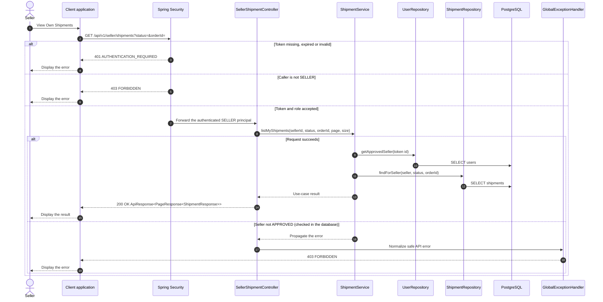

# Shipment - View Own Shipments — Sequence Diagram

- **Use-case spec:** [view-own-shipments.vi.md](../../usecase-specification/seller/view-own-shipments.vi.md)
- **API route/status:** `GET /api/v1/seller/shipments?status=&orderId=` — Confirmed
- **Feature API contract:** [features/shipment/API_CONTRACT.md](../../features/shipment/API_CONTRACT.md)

